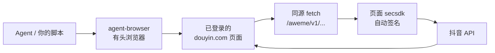

<div align="center">

# 🧹 抖音账号清理 Skill

**一句话把「喜欢 / 收藏 / 非互关关注」清干净 —— 给 AI Agent 的开箱即用技能包**

[](./SKILL.md)
[](https://nodejs.org)
[](https://github.com/vercel-labs/agent-browser)

[]()

[快速开始](#-快速开始) · [三种能力](#-三种能力) · [工作原理](#-工作原理) · [避坑指南](#-三个必踩的坑) · [常见问题](#-faq)

</div>

> 本文件是**给人看的**介绍。给 AI Agent 的入口是 [`SKILL.md`](./SKILL.md)，参考文档在 [`references/`](./references)，可直接执行的工具在 [`scripts/`](./scripts)。

---

## ✨ 它解决什么问题

抖音网页版在 2026 年启用了 **Argus 风控插件**，把"脚本化清理账号"变成了三道墙：

| 你缺什么 | 抖音回你什么 |
|---|---|
| `uifid` | `403 Blocked by ArgusSecurityPlugin Uifid Not Found` |
| `x-secsdk-web-signature` | `403 ... Signature Not Found` |
| 签名是旧的 / 别处抓的 | `403 ... Sign Invalid` |

而 `x-secsdk-web-signature` 是页面里的 secsdk **在发送瞬间**按会话生成的，绑定路径和时间，**不能离线算、不能回放**。所以：

> ❌ 用 Python/Node 直接打 API —— 403
> ❌ 回放浏览器里抓到的签名 —— `Sign Invalid`
> ❌ 把旧 cookie 注入新浏览器 —— 页面依旧"未登录"
> ✅ **在已登录页面的上下文里发同源 `fetch`，让页面自己签名**

这个 Skill 就是把 ✅ 这条路走通、走稳、并沉淀成可复用流程的产物。

单账号实测跑通：**5,000+ 条点赞、600+ 条视频收藏、28 个合集、860+ 个非互关关注**，累计 **6,500+ 次写操作**，零脚本崩溃、零误删互关。

---

## 👀 谁适合用

- **想重置推荐口味**：点赞和收藏是喂给算法最强的信号，清空后信息流会明显"换血"；
- **账号交接 / 转手前**：把个人痕迹（喜欢、收藏、关注）清干净；
- **整理控**：收藏夹里躺着几千条"以后再看"，不如一次清空；
- **研究 Web 逆向 / 风控的开发者**：`references/endpoints.md` 和 `troubleshooting.md` 全是 2026-10 的实测结论，省去重复抓包。

---

## 🎯 三种能力

| 能力 | 做什么 | 核心接口 | 实测节奏 |
|---|---|---|---|
| ❤️ **取消点赞** | 清空「喜欢」列表，视频 + 图文都清 | `cancel/item/digg/multi` | 50 条/请求，约 5–15 分钟/千条 |
| ⭐ **清空收藏** | 视频 / 音乐 / 合集 / 短剧 / 收藏夹，五类全覆盖 | `aweme/cancel/collect/multi` 等 | 20 条/页，约 2–5 分钟/千条 |
| 👥 **取关非互关** | 只取关 `follower_status=0` 的人，互关一个不动 | `commit/follow/user` | 1 条/请求，约 15–20 分钟/千条 |

支持**五种收藏子类型**是它和普通脚本最大的区别——只清视频，你会剩下音乐、合集和一整排收藏夹。

---

## 🚀 快速开始

### 1. 装依赖

```bash
npm install -g agent-browser
agent-browser install          # 下载 Chromium
```

### 2. 把 Skill 放进 Agent 的技能目录

```bash
# 用户级（推荐）
git clone <你的仓库地址> ~/.dsh/skills/douyin-account-cleanup
# 或直接把本目录拷进去
```

Windows 下即 `%USERPROFILE%\.dsh\skills\douyin-account-cleanup`。

### 3. 打开有头浏览器，让用户扫码登录

```powershell
agent-browser open --headed https://www.douyin.com/user/self
agent-browser cookies clear
agent-browser reload
```

### 4. 确认会话可用（**必须**）

```powershell
agent-browser eval "(async()=>{const r=await fetch('/aweme/v1/web/user/profile/self/?device_platform=webapp&aid=6383&channel=channel_pc_web',{credentials:'include'});const j=await r.json();return JSON.stringify({sc:j.status_code,nick:j.user&&j.user.nickname})})()"
```

返回 `{"sc":0,"nick":"..."}` 才能继续；`status_code: 8` 表示会话已失效，只能重新扫码。

### 5. 注入工具箱，先预演再真跑

```powershell
powershell -ExecutionPolicy Bypass -File scripts\inject.ps1

agent-browser eval "(async()=>JSON.stringify(await DY.check()))()"
agent-browser eval "DY.clearLikes({dryRun:true})"       # 只统计
agent-browser eval "JSON.stringify(DY.report())"         # 看数字

agent-browser eval "DY.clearLikes({dryRun:false})"       # 确认后再删
```

> 💡 不要用 `agent-browser eval (Get-Content ...)` 注入：脚本 15KB，参数会被截断，报 `SyntaxError: Invalid or unexpected token`。用配套的 `inject.ps1` 分片注入。

### 跑起来长这样

```jsonc
// 预演：只统计，不动数据
{"job":"favorites","running":false,"ok":0,"fail":0,"pages":6,
 "note":"dry-run: 待取消 0 条（6 页）","err":"","elapsed":6292}

// 真跑：一边删一边报进度
{"job":"likes","running":true,"ok":1350,"fail":0,"pages":27,
 "note":"","err":"","elapsed":38412}

// 收尾：拿到最终数字，再按第 5 步验收
{"job":"likes","running":false,"ok":5048,"fail":0,"pages":101,
 "note":"empty","err":"","elapsed":158734}
```

- `ok` = 成功取消条数；
- `fail` 连续增长或 `err` 非空 → 立刻 `DY.stop()`；
- `note: "stuck"` = 首页长时间没变化，脚本已自动刹车。

---

## 🧠 工作原理



关键点：

1. **同源相对路径** —— `/aweme/v1/...`，不要写 `https://www.douyin.com/...`；
2. **只带必要参数** —— 多带 `uid=`、`x-tt-session-dtrait`、`x-secsdk-csrf-token` 反而 403；
3. **先 1 条试跑** —— `status_code:0` 再放大；
4. **以列表验收** —— `favoriting_count` 有缓存，别信计数。

---

## 🕳 三个必踩的坑

> 这一节是整套东西里最值钱的部分，能帮你省下至少半天。

### 坑 1：收藏列表带 `cursor=0` 是"空窗页"

```
POST /aweme/v1/web/aweme/listcollection/?cursor=0&count=18
→ { "aweme_list": null, "has_more": 1, "disabled_item_ids": [...] }
```

看着像"已经清空"，实际还有上千条。**第一次请求不要带 `cursor`**，拿到返回的 `cursor` 再往下翻。

### 坑 2：图文点赞的 `item_type_map` 必须是 2

```json
{ "7694932631481792335": 2 }   // aweme_type === 68 的图文
```

全填 `0` 时接口照样返回 `status_code:0`，但这些 id 会进 `fatal_ids`，点赞根本没删。症状：跑完还剩一大半，而且全是图文。

### 坑 3：关注列表 `max_time` 含首条，`offset` 是摆设

- 把响应的 `max_time` 原样传回去，**只前进 1 条**；
- `offset=20/40` 返回的还是同一页。

所以别做"按时间翻页再统一删"，改成 **拉首页 → 取关页内非互关 → 重新拉首页**，靠列表收缩自然推进。

更多： [`references/troubleshooting.md`](./references/troubleshooting.md)

---

## 📁 目录结构

```
douyin-account-cleanup/
├── SKILL.md                  # Agent 入口：完整流程、节奏、验收、红线
├── README.md                 # 你正在看的这份（人类向）
├── references/
│   ├── endpoints.md          # 每个接口的参数 / 表单 / 响应 / 真实样例
│   └── troubleshooting.md    # 14 条错误对照表、无效方案、风控止损
└── scripts/
    ├── douyin_toolkit.js     # window.DY：三大任务，默认 dry-run
    └── inject.ps1            # 分片注入，绕开 eval 长度限制
```

---

## 🛡 安全与风控

| 项目 | 建议 |
|---|---|
| 批量大小 | 点赞 50/请求、收藏 20/页、取关 1 条/请求 |
| 间隔 | 250–600ms，每 50 条停 2.5s |
| 单次会话上限 | **≤ 2000 条写操作** |
| 出现验证码 / 身份验证 | 立即停手，人工完成，当天不再批量 |
| 会话被踢（`status_code:8`） | 只能重新扫码；当天停止 |
| 冷却 | 完成后 **24 小时**内不再批量写 |

**红线**：只操作自己的账号并取得明确授权；不做登录绕过、不破解验证码、不伪造签名；cookie / uifid 不要提交进仓库。

---

## ✅ 验收清单

```powershell
agent-browser eval "(async()=>{const b='/aweme/v1/web/';const q='device_platform=webapp&aid=6383&channel=channel_pc_web&platform=PC';const p=await (await fetch(b+'user/profile/self/?'+q,{credentials:'include'})).json();return JSON.stringify({fav:p.user.favoriting_count,following:p.user.following_count})})()"
```

- [ ] 视频 / 音乐 / 合集 / 短剧收藏均为 0
- [ ] 点赞首页 `aweme_list` 为空
- [ ] 关注列表剩余条目 `follower_status` 全为 1（互关）
- [ ] 收藏夹点进去显示「暂无内容」

---

## ❓ FAQ

<details>
<summary><b>为什么要开有头浏览器？不能 headless 吗？</b></summary>

首登几乎必然出滑块或短信验证，headless 下没法人工完成，只能卡住。登录成功后理论上可以切 headless，但实测无头环境更容易被重新弹验证，**建议全程有头**。
</details>

<details>
<summary><b>为什么不用现成的 Python 抖音库？</b></summary>

它们的签名逻辑停留在 `a_bogus` 时代。2026 版 Argus 需要 secsdk 的运行时会话签名，离线生成器只能过 `profile/self`，列表和写接口一律 403。
</details>

<details>
<summary><b>取消收藏后计数没变？</b></summary>

`favoriting_count` 有缓存，延迟几分钟甚至一直不动。以 `listcollection` 的实际返回为准。
</details>

<details>
<summary><b>还剩几条删不掉？</b></summary>

多半是 `fatal_ids` 里的失效作品（作者已删/下架），抖音侧不允许再取消，属于正常残留。
</details>

<details>
<summary><b>会被封号吗？</b></summary>

高频批量写有风险：轻则弹验证、踢会话，重则临时限制互动。按上面的节奏分批、跨天做，风险显著降低。**后果自负**。
</details>

---

## 🤝 参与贡献

欢迎 **Fork → 改 → PR**：

- 🐛 发现新的接口变更 / 报错形态 → 开 Issue，附上 `status_code` 和 `status_msg`
- 🔌 新增子类型（如新的收藏类型、直播关注）→ 先抓页面真实 XHR，再补 `references/endpoints.md`
- 📝 改进排障表 / 补平台差异（macOS、Linux）→ 直接 PR
- ⭐ **如果这个 Skill 帮你省下了一个下午，点个 Star 就是最好的支持**

<div align="center">

**⭐ Star · 🍴 Fork · 🧠 Issue**

*让下一个被 Argus 拦住的人，少走半天弯路。*

</div>

---

<div align="center">
<sub>仅供个人账号管理与技术研究使用 · 使用前请阅读并遵守抖音用户协议 · 2026-10 实测于抖音 Web / 桌面端 8.7.0 + Windows 11 + Node 22</sub>
</div>
